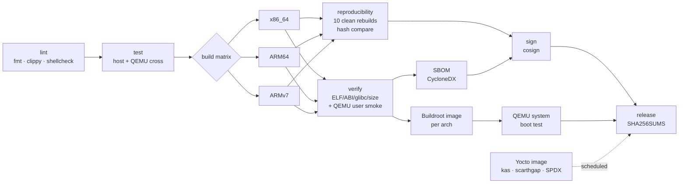

# Multi-Architecture Build & CI/CD Pipeline for Embedded Linux

A GitLab CI/CD pipeline that cross-compiles a Rust application for **x86_64, ARM64 and ARMv7**, verifies every artifact, proves the build is **bit-for-bit reproducible**, generates an **SBOM**, **signs** the outputs, packages them into **Buildroot and Yocto** images and **boot-tests** them in **QEMU**.

The application being shipped is `edgeprobe`, a small dependency-free Rust health probe for edge devices (CPU, memory, load, uptime as one JSON line). It is deliberately simple. The pipeline is the actual project.

```
GitLab CI/CD · Rust · cross-compilation · Yocto/Buildroot · QEMU · SBOM (CycloneDX + SPDX) · cosign · embedded Linux
```

## Pipeline



| Stage | Job | What it does |
|---|---|---|
| prepare | `builder-image` | Builds the pinned builder container (`ci/Dockerfile`) when it changes |
| lint | `fmt-clippy`, `shellcheck` | `cargo fmt --check`, `clippy -D warnings`, shellcheck on all scripts |
| test | `test-host`, `test-cross` | Unit + CLI tests on host; unit tests for ARM64/ARMv7 run **under QEMU user-mode** |
| build | `build` ×3 | Cross-compiles per architecture via one `parallel:matrix` (`scripts/build.sh`) |
| verify | `verify` ×3 | Static checks on the ELF, then runs it under QEMU (`verify.sh`, `qemu-user-smoke.sh`) |
| verify | `reproducibility` ×3 | Rebuilds the same commit **10 times** from clean, in different directories; all SHA-256 hashes must match each other and the build-job artifact |
| sbom-sign | `sbom` ×3 | CycloneDX 1.5 SBOM per arch, bound to the exact binary by its SHA-256 |
| sbom-sign | `sign` ×3 | cosign signs binary + SBOM and verifies the signatures straight away |
| image | `buildroot-image` ×3 | Buildroot 2024.02 LTS image containing the **already verified** binary |
| image | `yocto-image` ×3 | kas + Yocto scarthgap `core-image-minimal` building edgeprobe from source, with SPDX SBOM |
| boot-test | `qemu-boot-test` ×3 | Boots each image in `qemu-system-*` and waits for `EDGEPROBE_BOOT_OK` on the serial console |
| release | `release` | On tags: per-arch binaries, SBOMs, `SHA256SUMS`, reproducibility reports |

To add an architecture, add one entry to `.arch-matrix` in `.gitlab-ci.yml` and one mapping in `scripts/common.sh`.

## Build verification

`scripts/verify.sh` gates every artifact before anything downstream may use it:

| Check | Why |
|---|---|
| SHA-256 matches the recorded checksum | Artifact was not changed between jobs |
| ELF class + machine (+ hard-float ABI for ARMv7) | Catches the wrong linker or target being used |
| Dynamic loader path | Must exist on the target rootfs |
| Stripped (no `.symtab`) | Size and no internal symbols on device |
| No build-machine paths in the binary | Path leaks break reproducibility across runners |
| Highest required glibc ≤ `MAX_GLIBC` | Binary must run on the oldest supported rootfs |
| Size ≤ `MAX_SIZE_KB` | Budget for constrained devices |

## Reproducibility

The same commit should produce the same bytes on any runner. What makes that work here:

- **Pinned toolchain**: `rust-toolchain.toml` (1.80.1) + pinned builder image
- **No timestamps**: `build.rs` embeds `SOURCE_DATE_EPOCH` (last commit time), never "now"
- **No paths**: `--remap-path-prefix` for every build root; `verify.sh` fails on leaked paths
- **Deterministic codegen**: `codegen-units = 1`, LTO, `incremental = false`
- **Locked deps**: `--locked`, and zero external crates
- **Reproducible SBOM too**: random `serialNumber` dropped, timestamp = `SOURCE_DATE_EPOCH`
- **Images**: `BR2_REPRODUCIBLE=y` in Buildroot; OE-core reproducible builds in Yocto

Which of these actually matter was measured, see [`docs/DESIGN.md`](docs/DESIGN.md#what-actually-matters-for-reproducibility-measured).

`scripts/repro-check.sh` proves it: N clean builds in **different directories** (so a path leak would show up as a mismatch), then compares all hashes. Sample local run: [`docs/results/reproducibility-x86_64.txt`](docs/results/reproducibility-x86_64.txt) (10/10 identical).

## Supply chain: SBOM and signing

- **CycloneDX** SBOM per binary (`cargo-cyclonedx`), enriched with the binary's SHA-256, target triple and toolchain version, so the SBOM describes exactly one artifact.
- **SPDX** SBOM for the whole Yocto image (`create-spdx`).
- **cosign** signs both binary and SBOM; the job verifies the signature right after signing.

Setup (one time):

```bash
cosign generate-key-pair            # creates cosign.key + cosign.pub
git add cosign.pub                  # public key in the repo for verification
# GitLab > Settings > CI/CD > Variables:
#   COSIGN_PRIVATE_KEY  type=File, contents of cosign.key
#   COSIGN_PASSWORD     masked
```

Without these variables the `sign` job is skipped and the rest of the pipeline still runs.

Verify a release artifact:

```bash
cosign verify-blob --key cosign.pub --insecure-ignore-tlog=true \
  --signature edgeprobe.sig edgeprobe
```

## Embedded Linux images

**Buildroot** (`buildroot/`, a `BR2_EXTERNAL` tree): starts from Buildroot's stock `qemu_x86_64`, `qemu_aarch64_virt` and `qemu_arm_vexpress` defconfigs and merges `configs/edgeprobe.fragment` (glibc, reproducible, our package). The package installs the binary from `dist/<arch>/` after checking its SHA-256, so **the image ships the exact bytes that were verified, hash-checked and signed**, not a rebuild.

**Yocto** (`yocto/`, layer `meta-edgeprobe` + kas configs): builds edgeprobe from source with the Yocto Rust toolchain (`inherit cargo`) for `qemux86-64`, `qemuarm64` and `qemuarm`. This is an independent second build path, and it produces an SPDX SBOM for the whole image.

Both images run `packaging/edgeprobe.init` at boot, which prints `EDGEPROBE_BOOT_OK` (or `_FAIL`) on the console. That marker is what `scripts/qemu-boot-test.sh` waits for.

## Run it locally

Requirements (Debian/Ubuntu): `rustup`, `gcc-aarch64-linux-gnu`, `gcc-arm-linux-gnueabihf`, `libc6-dev-{arm64,armhf}-cross`, `qemu-user`, `jq`, `shellcheck`, `cargo-cyclonedx`, `cosign`. Or use the CI image: `make ci-local`.

```bash
make lint test        # same as the lint + test stages
make build verify     # cross-compile all 3 arches + verification
make smoke            # run each binary under QEMU user-mode
make repro RUNS=10    # reproducibility check
make sbom sign        # CycloneDX SBOM + cosign
make images boot      # Buildroot images + QEMU boot test (slow)

kas build yocto/kas/qemuarm64.yml   # Yocto image (very slow, needs ~100 GB)
```

Single target: `scripts/build.sh aarch64-unknown-linux-gnu`, etc.

Example output (ARM64 under QEMU):

```json
{"name":"edgeprobe","version":"0.1.0","target":"aarch64-unknown-linux-gnu","arch":"aarch64","commit":"925910f1","source_date_epoch":1795529704}
{"status":"healthy","arch":"aarch64","cpus":2,"mem_used_pct":7.3,"load1":0.29, ...}
```

More results: [`docs/results/`](docs/results/).

## Repository layout

```
.gitlab-ci.yml            the pipeline
ci/Dockerfile             pinned builder image (Rust, cross GCC, QEMU, cosign, cargo-cyclonedx)
.cargo/config.toml        cross linkers, QEMU runners, reproducibility rustflags
rust-toolchain.toml       pinned compiler + targets
src/                      edgeprobe (Rust, no dependencies)
tests/                    CLI integration tests
scripts/                  one script per pipeline step (CI and local use the same scripts)
packaging/edgeprobe.init  init script shared by both images
buildroot/                BR2_EXTERNAL tree: package + config fragment
yocto/                    meta-edgeprobe layer + kas configs
docs/                     design notes and sample results
```

## Design notes

See [`docs/DESIGN.md`](docs/DESIGN.md) for why things are done this way and what is left out.

## License

MIT
